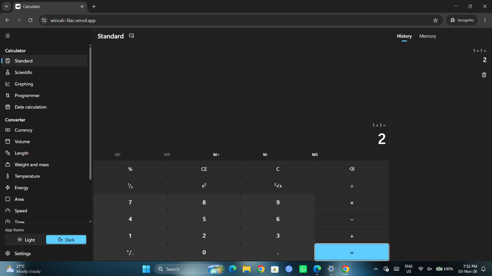
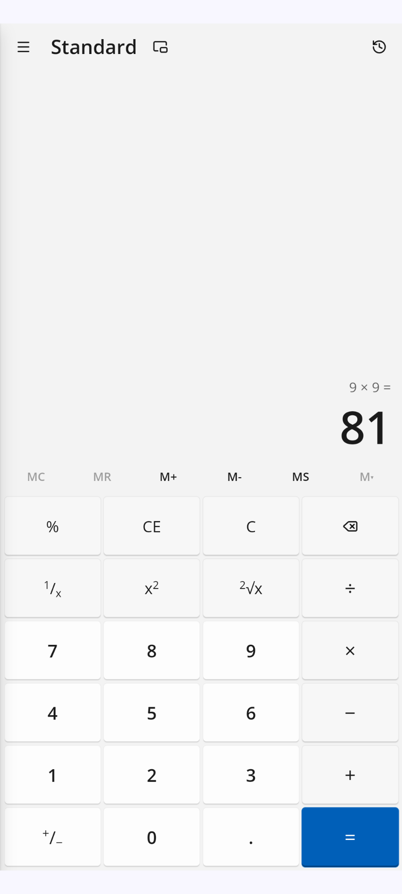

<div align="center">


# WinUI Calc

### Experience Windows 11 Calculator on your Android / macOS device today! 

A polished Android calculator that faithfully brings the modern Windows 11 Calculator (based on WinUI3) experience to your Android, macOS, ChromeOS & Linux devices. 

[](LICENSE)
[]()
[]()

</div>

---

# 📖 About

WinUI Calc is an Android port of the Windows 11 Calculator.

It brings the official Windows 11 Calculator experience to Android devices.

Whether you're calculating equations, writing documents, drawing graph or converting units, WinUI Calc delivers an elegant and best experience designed specifically for Android devices and web. 

---

# ✨ Features

- 🎨 Microsoft WinUI 3
- 📱 Optimised for phones
- 📟 Optimised for tablets & websites
- 📖 Temporary History
- 🌙 Dark Theme
- ☀️ Light Theme
- ⚡ Fast and responsive
- 🚫 Zero Ads
- ❤️ Open Source

---

# 📸 Screenshots

<b>Web Version [For any device with web browser (eg. Chrome, Edge, Safari, etc.)]</b>

<p><p>

<b>Android Tab / Phone / Foldables Version [Android 10 & Up]</b>

<p><p>

---

# 📋 Requirements

- Android 10+ 
- ARM64-v8a / ARM64-v7a / x86_64
- Internet connection
- Minimum 2 GB RAM recommended

---

# 🚀 Installation

Download the latest APK from the Releases page.

Or build from source:

```bash
git clone https://github.com/techambient/WinUICalc.git
```

Open the project using Android Studio and press **Run**.

---

# 🛠️ Built With

- Kotlin
- Jetpack Compose
- Material 3 Expressive
- AndroidX
- Kotlin Coroutines
- Markdown
- Gradle Kotlin DSL
- React Native (Android & Web version)

---

# 🎨 Design

WinUI Calc follows Microsoft's latest WinUI 3 Design guidelines.

- WinUI 3
- Pixel by pixel UI clone
- Edge-to-edge UI
- Adaptive layouts
- Responsive typography

---

# ❤️ Why WinUI Calc?

Unlike many calculator applications, WinUI Calc focuses on:

- Clean UI (clone from Windows 11 Calculator)
- Performance
- Open Source
- Modern Web & Android experience
- No permissions needed at all
- Unlimited free usage

---

# 🤝 Contributing

Contributions are always welcome!

You can help by:

- Reporting bugs
- Suggesting features
- Improving documentation
- Submitting pull requests

---

# ⭐ Support

If you enjoy WinUI Calc, please consider giving this repository a ⭐ to help keep it alive!! 

---

# 📄 License

Licensed under the GPL-v3 License.

See [LICENSE](LICENSE) for more information.

---

<div align="center">

Made with ❤️ by techambient (Ambient)

</div>
